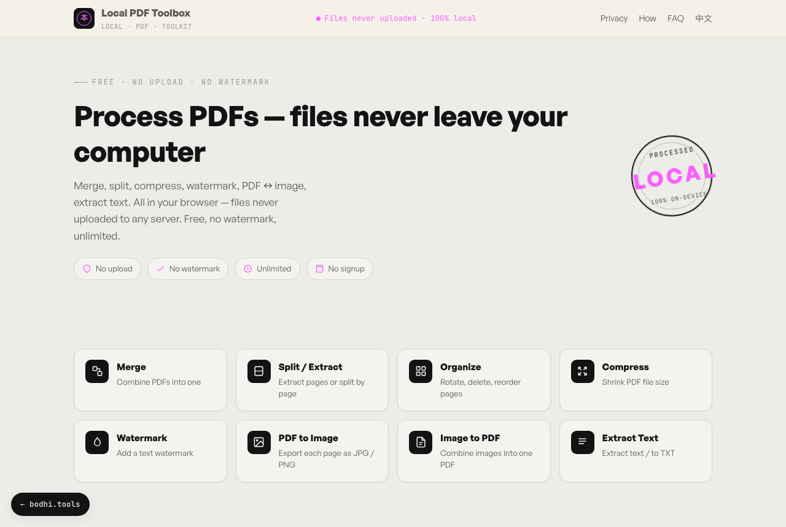

# 本地 PDF 工具箱

[English](README.md) · **简体中文**

8 个完全在浏览器里运行的 PDF 工具：合并、拆分、整理页面、压缩、加水印、PDF 与图片互转、提取文字。文件不离开你的设备，合同、证件等敏感文件也可以放心处理。

**在线使用：** https://pdf.bodhi.tools/



## 工具

| 工具 | 功能 |
|---|---|
| 合并 | 把多个 PDF 合成一个，合并前可调整顺序 |
| 拆分 | 按页码范围（如 `1-3,5,8-10`）提取成新 PDF，或把每一页拆成单独的 PDF（打包为 ZIP 下载） |
| 整理页面 | 通过页面缩略图旋转、删除页面，再导出新 PDF |
| 压缩 | 压缩扫描件或图片较多的 PDF，有三档强度（见下方说明） |
| 加水印 | 在每一页加斜向文字水印，可平铺或居中，颜色可选灰、红、蓝，透明度可调；支持中文等任意文字 |
| PDF 转图片 | 把页面导出为 PNG 或 JPG，可选 1.5×、2×、3× 清晰度；多页自动打包为 ZIP |
| 图片转 PDF | 把 JPG、PNG、WebP 等浏览器能打开的图片合成一个 PDF，可设页面尺寸（适应图片、A4、Letter）和页边距 |
| 提取文字 | 提取 PDF 中可选中的文字，可复制或保存为 `.txt` |

无水印、无需注册，除设备性能外不限文件大小和次数。界面支持中英文。

**关于压缩：** 压缩会把每一页重新渲染成 JPEG 图片，文件变小了，但文字将无法再选中或搜索。适合扫描件和图片多的文件，不适合需要搜索的文字文档。

**关于提取文字：** 读取的是 PDF 里已有的文字层。没有文字层的扫描件需要用 OCR，例如 [bodhi1425/ocr](https://github.com/bodhi1425/ocr)。

## 实现原理

- [pdf-lib](https://pdf-lib.js.org) 负责创建和编辑 PDF（合并、拆分、旋转、删除、加水印、图片转 PDF）。
- [PDF.js](https://mozilla.github.io/pdf.js/) 负责把页面渲染到 canvas（缩略图、PDF 转图片、压缩），并读取文字层。
- 水印文字先绘制在 canvas 上，再作为图片嵌入，所以中文等非拉丁文字无需字体文件也能正常显示。
- [JSZip](https://stuk.github.io/jszip/) 负责把多个结果文件打包。

18 个 HTML 页面（首页和 8 个工具页，各有中英文两版）由 `scripts/gen-pages.mjs` 根据 `scripts/site.config.mjs` 中的文案和 SEO 数据生成。

## 隐私说明

- 文件只在你的浏览器里读取和处理，应用没有任何上传接口；打开浏览器开发者工具的网络面板即可验证。
- PDF.js 的 worker 随应用一起打包，页面只从 Google Fonts 和 Fontshare 加载字体。
- pdf.bodhi.tools 上的线上版本接入了 Cloudflare Web Analytics，只统计页面访问量，不使用 Cookie。自行部署时如不需要，从 `scripts/gen-pages.mjs` 的 `head` 模板中删除 `cloudflareinsights` 脚本标签，然后重新生成页面。

## 本地运行

需要 Node.js 20.19+（或 22.12+）和 [pnpm](https://pnpm.io)。

```bash
git clone https://github.com/bodhi1425/local-pdf-toolbox.git
cd local-pdf-toolbox
pnpm install
pnpm dev     # 重新生成页面，然后启动 http://localhost:5173
pnpm build   # 重新生成页面、类型检查，静态文件输出到 dist/
pnpm gen     # 只重新生成 HTML 页面
```

`dist/` 里只有静态文件，可以部署到 Cloudflare Pages、Netlify、GitHub Pages 或任何 Web 服务器。

修改页面文案或新增工具时，请编辑 `scripts/site.config.mjs` 后运行 `pnpm gen`，不要手动修改生成出来的 `index.html`。

## 目录结构

```
scripts/site.config.mjs   页面文案、SEO 信息和工具列表（中英文）
scripts/gen-pages.mjs     生成 HTML 页面和 public/sitemap.xml
src/tools/                每个工具一个模块（merge.ts、split.ts……）
src/lib/                  PDF.js 配置、多语言、格式化工具、图标
src/ui/                   拖放区、文件列表和面板组件
index.html、*/index.html  生成的中文页
en/                       生成的英文页
```

## 依赖

| 包 | 用途 | 许可证 |
|---|---|---|
| [pdf-lib](https://pdf-lib.js.org) | 创建和编辑 PDF | MIT |
| [PDF.js](https://mozilla.github.io/pdf.js/)（`pdfjs-dist`） | 页面渲染和文字提取 | Apache-2.0 |
| [JSZip](https://stuk.github.io/jszip/) | 打包下载 | MIT（MIT / GPL-3.0 双许可） |
| [Vite](https://vite.dev)、[TypeScript](https://www.typescriptlang.org) | 构建 | MIT、Apache-2.0 |

## 更多本地处理工具

以下工具都完全在浏览器中运行：

- [image-compressor](https://github.com/bodhi1425/image-compressor)：把图片压缩到指定 KB
- [heic-converter](https://github.com/bodhi1425/heic-converter)：iPhone HEIC 照片转 JPG 或 PNG
- [qrcode](https://github.com/bodhi1425/qrcode)：带 logo、渐变、Wi-Fi 和名片的二维码生成器
- [ocr](https://github.com/bodhi1425/ocr)：图片转文字
- [cutout](https://github.com/bodhi1425/cutout)：用本地 AI 模型抠图去背景

## 参与贡献

欢迎提交问题反馈和 Pull Request。较大的改动请先开 issue 讨论。

## 许可证

[MIT](LICENSE) © 2026 bodhi1425
